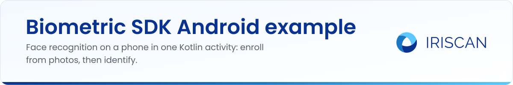

# Biometric SDK Android example

A small Kotlin app that shows the [Iriscan Biometric SDK](https://github.com/biometric-technologies/biometric-sdk) doing face recognition on an Android phone, with no server involved. It enrolls two people from bundled photos, then lets you pick a random test photo and asks the SDK who is in it. Use it to see the SDK API in a working project before you add it to your own app.

## What it does

- Initializes the SDK with a FaceNet model bundled in `app/src/main/assets/facenet.tflite` (160 x 160 input, 128-value embedding, match threshold 10.0).
- Builds a tiny in-memory "database" at startup: every photo in the `howard/` and `sheldon/` asset folders is turned into a face template.
- "Load random" shows one of four bundled test photos (`img1.jpg` to `img4.jpg`).
- "Detect" extracts a template from the shown photo, compares it with every enrolled template and shows the name of the first person that matches, or "Unknown".
- Runs the SDK calls on a thread pool so the UI stays responsive.

The whole demo is one file, `app/src/main/java/net/iriscan/sdktest/MainActivity.kt`. A commented-out block there shows how to load the same model from a URL instead of the assets folder.

## How to run

You need Android Studio with an Android SDK that includes API level 32, and a device or emulator on Android 7.0 (API 24) or newer.

1. Clone the repository and open the folder in Android Studio (File, Open).
2. Let Gradle sync. The SDK comes from Maven Central as `net.iriscan:biometric-sdk-android:0.2.2`; nothing else has to be installed.
3. Press Run. Wait for the "Db initialized" toast, then tap "Load random" and "Detect".

The project uses Android Gradle Plugin 7.3.0 and Kotlin 1.7.20.

Note that this example pins SDK version 0.2.2, whose initialization call is `BiometricSdkFactory.configure(...)`. Newer SDK releases (0.6.0 at the time of writing) use `BiometricSdkFactory.initialize(...)` and a slightly different configuration builder; see [docs.iriscan.com/sdk](https://docs.iriscan.com/sdk) for the current API.

## Related repositories

- [biometric-sdk](https://github.com/biometric-technologies/biometric-sdk): the SDK itself (Android, iOS, JVM).
- [biometric-sdk-ios-example](https://github.com/biometric-technologies/biometric-sdk-ios-example): the same demo in SwiftUI.
- [biometric-sdk-react-native](https://github.com/biometric-technologies/biometric-sdk-react-native): React Native wrapper with face comparison and liveness.
- [docs](https://github.com/biometric-technologies/docs): source of the developer documentation at docs.iriscan.com.

## License

License: not yet specified. The Biometric SDK this example depends on is licensed under GPL-3.0; a commercial license for closed-source products is available: https://www.iriscan.com/commercial-license.

## Contact

info@iriscan.com, https://www.iriscan.com
